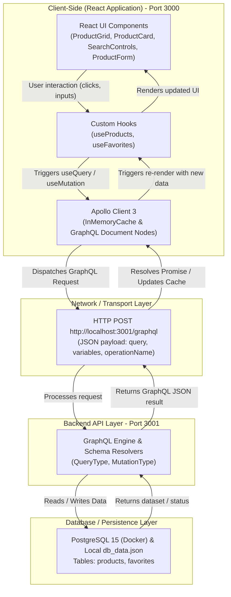
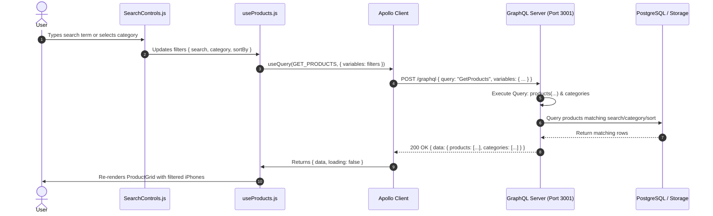
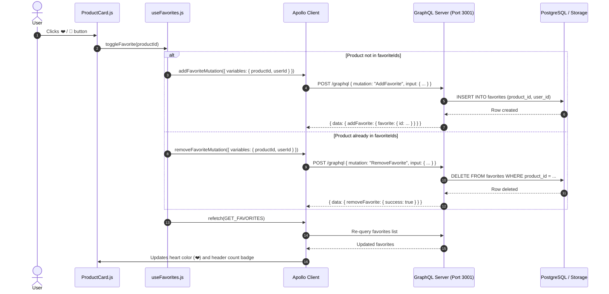
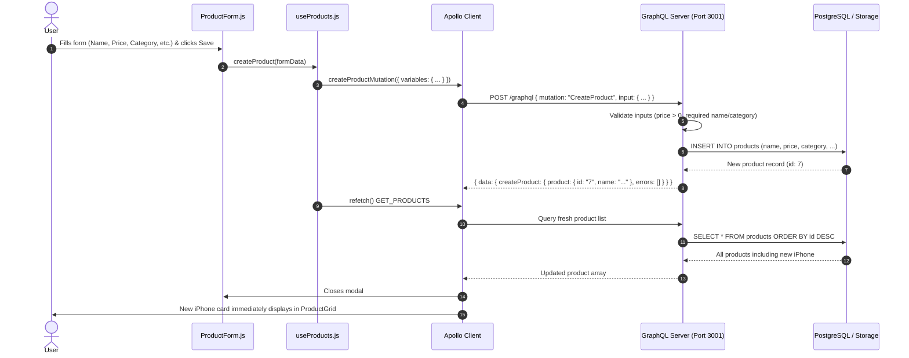
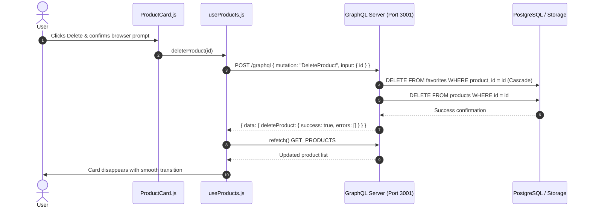

# iPhone Shop Application — Architecture & Operation Flow

This document visualizes the complete end-to-end operation flow of the iPhone Shop Management system, showing which technology stack is used at each step, where GraphQL fits in, and how data moves between layers.

---

## 1. High-Level Architecture Overview



---

## 2. Technology Stack Roles in the Flow

| Layer | Technology | Primary Role in the Flow |
| :--- | :--- | :--- |
| **Presentation (UI)** | **React 18 & CSS Utilities** | Renders product cards, search inputs, dropdowns, and modal dialogs. Listens for user events. |
| **State Management** | **React Hooks (`useState`, `useEffect`)** | Maintains local UI state (modal open/close, active search term, selected filters). |
| **GraphQL Client** | **Apollo Client (`@apollo/client`)** | Manages remote data, caches GraphQL responses in memory (`InMemoryCache`), and triggers automatic component re-renders. |
| **Data Contracts** | **GraphQL (`graphql-tag` / `gql`)** | Defines exact schema contracts: [`queries.js`](file:///c:/Coding%20Project/Iphone%20Management/iphone-shop-frontend/src/graphql/queries.js) & [`mutations.js`](file:///c:/Coding%20Project/Iphone%20Management/iphone-shop-frontend/src/graphql/mutations.js). No over-fetching or under-fetching. |
| **Network Protocol** | **HTTP / JSON / CORS** | Sends GraphQL queries and mutations as HTTP `POST` requests to `http://localhost:3001/graphql`. |
| **API Server** | **Node.js GraphQL / Rails GraphQL** | Validates incoming GraphQL AST, executes resolvers for requested fields, and enforces business rules. |
| **Database** | **PostgreSQL 15 / pgAdmin / JSON** | Stores relational entities (`products` and `favorites`) with foreign keys and unique constraints. |

---

## 3. Detailed Operational Flows

### Flow A: Fetching, Searching & Filtering Products

When a user opens the page, changes a category, or types in the search bar:



* **Where GraphQL is used:**
  * Client sends:
    ```graphql
    query GetProducts($search: String, $category: String, $sortBy: String) {
      products(search: $search, category: $category, sortBy: $sortBy) {
        id
        name
        price
        category
        stock
      }
      categories
    }
    ```
  * Server executes field resolver `products(search, category, sortBy)`.

---

### Flow B: Adding / Removing Favorites (Heart Icon)

When the user clicks the heart icon on any iPhone card:



---

### Flow C: Adding a New Product

When an admin clicks **Add Product** and submits the form:



---

### Flow D: Deleting a Product

When the user clicks **Delete** on an iPhone card:



---

## 4. File-to-Layer Mapping Reference

```text
iphone-shop-app/
├── iphone-shop-frontend/src/
│   ├── apollo/client.js        <-- Configures Apollo Client HTTP link to :3001/graphql
│   ├── graphql/
│   │   ├── queries.js          <-- GET_PRODUCTS, GET_FAVORITES (gql definitions)
│   │   └── mutations.js        <-- CREATE_PRODUCT, UPDATE_PRODUCT, DELETE_PRODUCT, ADD/REMOVE_FAVORITE
│   ├── hooks/
│   │   ├── useProducts.js      <-- Handles product queries, refetches, and mutations
│   │   └── useFavorites.js     <-- Handles favorite status, toggling, and queries
│   └── components/
│       ├── Header.js           <-- App title bar
│       ├── SearchControls.js   <-- Search bar, category filter, sort by, favorites toggle
│       ├── ProductGrid.js      <-- Responsive cards grid container
│       ├── ProductCard.js      <-- Individual product card, price, stock, ❤️ button
│       ├── ProductDetail.js    <-- Full details modal
│       ├── ProductForm.js      <-- Add / Edit product modal
│       └── FavoritesList.js    <-- My Favorites drawer
│
├── iphone-shop-api/
│   ├── server.js               <-- Express/Node.js GraphQL schema, resolvers, CORS, and local db
│   ├── app/graphql/            <-- Ruby on Rails GraphQL types, queries, and mutations
│   └── db/seeds.rb             <-- Initial iPhone database seeds
│
└── PostgreSQL (Docker)         <-- Persistent relational storage on port 5432
```
